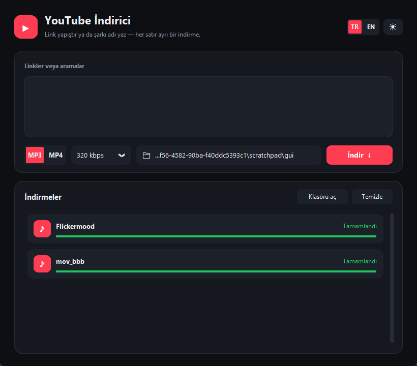

# yt-mp3-mp4

YouTube'dan MP3 / MP4 indiren sade, modern bir masaüstü uygulaması.
A clean, modern desktop app for downloading YouTube as MP3 / MP4.



## Türkçe

### Özellikler
- **Link ya da isim** — her satıra bir link veya şarkı adı yaz; link olmayanlar YouTube'da aranır, ilk sonuç indirilir.
- **Toplu indirme kuyruğu** — her satırın kendi ilerleme çubuğu, hızı ve durumu var; indirme sırasında arayüz donmaz.
- **MP3:** 320 / 192 / 128 kbps, **kapak resmi, başlık ve sanatçı bilgisi dosyaya gömülür.**
- **MP4:** Max / 1080p / 720p / 480p, her oynatıcıda açılan mp4 tercih edilir.
- Açık / koyu tema, Türkçe / İngilizce arayüz.
- Klasör, format, kalite, tema ve dil hatırlanır (`~/.yt-mp3-mp4.json`).
- FFmpeg ayrıca kurulmak zorunda değil; sistemde yoksa paketle gelen kullanılır.
- `Ctrl+Enter` ile indirmeyi başlat.

### Kurulum
```bash
git clone https://github.com/demirelmrtcn/yt-mp3-mp4.git
cd yt-mp3-mp4
python -m venv .venv
.venv\Scripts\activate        # macOS/Linux: source .venv/bin/activate
pip install -r requirements.txt
python app.py
```

> **Not:** yt-dlp, YouTube için bir JavaScript çalışma ortamına ihtiyaç duyar.
> [Node.js](https://nodejs.org), [Deno](https://deno.com) veya [Bun](https://bun.sh)'dan biri kurulu olmalı
> (uygulama hangisi varsa onu kullanır).

İndirmeler zamanla bozulursa önce yt-dlp'yi güncelle: `pip install -U "yt-dlp[default]"`

## English

### Features
- **Link or name** — one link or song name per line; anything that isn't a link is searched on YouTube and the first result is downloaded.
- **Batch queue** — each line gets its own progress bar, speed and status; the UI never freezes.
- **MP3:** 320 / 192 / 128 kbps with **embedded cover art, title and artist.**
- **MP4:** Max / 1080p / 720p / 480p, preferring mp4 streams that play everywhere.
- Light / dark theme, Turkish / English UI.
- Remembers folder, format, quality, theme and language (`~/.yt-mp3-mp4.json`).
- No separate FFmpeg install needed — a bundled one is used if none is on PATH.
- `Ctrl+Enter` starts the download.

### Install
```bash
git clone https://github.com/demirelmrtcn/yt-mp3-mp4.git
cd yt-mp3-mp4
python -m venv .venv
.venv\Scripts\activate        # macOS/Linux: source .venv/bin/activate
pip install -r requirements.txt
python app.py
```

> **Note:** yt-dlp needs a JavaScript runtime for YouTube. Install one of
> [Node.js](https://nodejs.org), [Deno](https://deno.com) or [Bun](https://bun.sh) — the app uses whichever is available.

If downloads start failing, update yt-dlp first: `pip install -U "yt-dlp[default]"`

---

Kişisel kullanım içindir; indirdiğin içeriğin haklarına ve YouTube kullanım koşullarına dikkat et.
For personal use; respect copyright and YouTube's Terms of Service.
